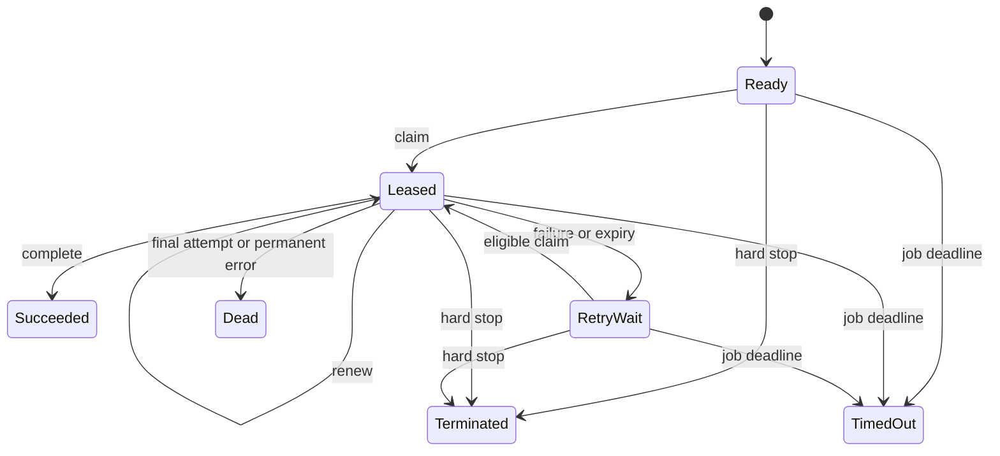

# Architecture and operations

One authority exclusively owns a store, and every decision about schedules, runs and leases is a transaction of that authority. Worker nodes contact the authority through a scoped port. They never open the data files. The decision code is the same on every platform. Only the edge that locks and opens the store differs.

## Platform edges

| Concern | Node.js and Bun | Browser |
| --- | --- | --- |
| Store | A canonical directory on local disk | A directory in the origin's private file system, named by the caller |
| Ownership | Operating-system whole-file lock | Exclusive Web Lock named after the store |
| Death of the owner | The lock releases with the process | The lock releases with the page or worker |
| File access | Native files with file and directory sync | Directory handles, one writable stream per write |
| Context | One process | A window or a dedicated worker |

The native lock survives event-loop pauses. Separate directories have independent ownership, even when one was copied from the other.

The browser edge uses directory handles because a scheduler that runs a page's handler functions has to open in a window. Synchronous access handles write in place and are faster, but they exist only in dedicated workers. Directory handles work in both contexts, so one code path serves both. Their cost is that the browser commits each write through a copy of the file, so a commit slows down as the log grows. VERIFIED: A probe on 2026-11-22 on macOS arm64 appended 1,000 commits of 0.9 KiB to a log that grew to 0.85 MiB. Averaged over 200 commits, a commit in a Chromium 159 window took 4.8 ms at the start and 6.7 ms at the end. Synchronous handles in a worker stayed near 3 ms. In a run of 500 commits, averaged over 100, Firefox 159 took 11 to 36 ms per commit and WebKit 27.2 about 12 ms. Automatic compaction bounds the log of superseded records and with it this cost. Kept history still grows the file.

## Durable decisions

One defuss-db 3.2.0 database named `defuss_scheduler` holds all state in three collections, and every command is one transaction across them. The schedules and runs collections track history and timestamps, because these are the records an operator follows over time. The ledger collection holds the calendar cursors and indexes, ready and expiry entries, resource groups, worker slots, receipts, and the indexes of refs and of unfinished runs. It is not tracked: this state changes with every grant and heartbeat, and its history would grow without bound and say nothing about a job. Document IDs are the ledger's keys, so one ordered index per collection serves every prefix scan.

Two records are split so that a history lists only meaningful changes. A lease deadline lives in the group record, so a renewal leaves the run's document untouched and a run gains a version only when its status changes. A schedule's calendar cursor lives in the ledger, so a schedule gains a version only when its definition or state changes. The history methods read the store's audit trail. VERIFIED: In a probe on 2026-11-22, defuss-db's effective timeline omitted two of five statuses that were recorded within the same millisecond, while the audit trail listed all five.

Each grant writes its run, token, incremented group fence, expiry index and slot in one transaction. The response follows the commit. Release checks the active token and group fence before updating the run and releasing the group. A second worker using the same worker ID still needs the current attempt's token. A reused claim sequence cannot acquire a second job.

A slot record holds the slot's last grant and a scan position. An empty answer is written only when it moves that position or drops the reference to a finished run, so a slot that polls while nothing is due commits nothing. Recording every answered sequence would turn each idle poll of each slot into a durable commit. VERIFIED: In a probe on 2026-11-23 under Node.js 26.13.1 an empty poll took 0.14 ms, against 4.1 ms when it committed a slot record. In Chromium 159 it took 2.9 ms against 9.6 ms. The price is one rare case. VERIFIED: In a probe on the same day, a duplicate of a claim that had been answered empty arrived after work came due and was granted. The slot's next claim got BUSY until that lease's time had passed, and the run was then granted as attempt 2. A slot record is a receipt and is kept like one. Once it is collected, a claim of that slot with an old sequence is a new claim.

A hard stop does what an edit's barrier rules out. `terminate` first marks each selected schedule as terminated in its own transaction, which removes its due entry and a draining edit. It then ends the unfinished runs in pages of pageSize, one transaction per page, so worker reports pass between the pages of a large backlog. The ledger keeps one entry per unfinished run under its schedule, and the sweep reads that index instead of scanning the scope's runs. A claim reads the schedule of its candidate and terminates the run in place of granting it when the schedule is terminated. VERIFIED: The store tests issue a claim between a stop and its sweep, and it is granted nothing. Ending a leased run releases its group and deletes its expiry entry. The holder's next report is stale, which aborts its handler's signal.

A second ready entry per run, `h/<handler>/<availability>/<scope>/<run>`, orders the ready runs of every scope by handler, and the same transactions write and delete it with the scope's entry. `ready` scans it up to now and returns the distinct scopes. A per-scope poll would make a worker for every scope send a claim to each scope every poll interval, idle or not. One scan per handler answers for all of them. A scope with more ready runs than the 512 entries one scan reads can hide later scopes until its worker drains it. A store written by 0.1.0 has no such entries: opening it writes them from the scope entries, one page per transaction, and then a marker. A crash before the marker repeats the pass, which writes the same entries again. VERIFIED by test: the entries and marker removed from a store come back on reopen, and the run is ready again.

A job is a run without a schedule. Workers, leases, retries, refs, histories and retention therefore treat it like an occurrence, and nothing waits for a calendar. Its run ID derives from the job ID, so `getJob` reads it without an index. A deadline index, `x/<deadline>/<scope>/<run>`, lets maintenance end overdue jobs a page per turn, and a claim or report that meets an overdue job ends it on the spot. Every ending passes through one function, which also removes the deadline entry and admits the follow-up its job names, so the ending and the follow-up commit together. Unfinished jobs sit under the scope's open prefix, which a stop of the whole scope sweeps. Follow-ups sit under their own prefix, `uf/`. Why: a stop of the whole scope sweeps from the head of its prefix until a page comes back short, so it would end the termination notices it had just admitted on some pages and miss them on others.

The authority serializes transactions on a FIFO promise queue. This makes an indexed scan and its point updates one serial decision. Filesystem commit throughput and the length of the admission queue bound one authority. Worker code runs outside this queue. Ready entries are ordered by availability within the scope. A slot saves a continuation after a full page of incompatible or blocked candidates. This lets a later eligible job progress without an unbounded scan. Expiry, due-calendar and retention scans have separate budgets. A rotating due cursor lets another scope progress while an earlier scope is saturated.

The format marker rejects unrecognized stores. Transactions advance the calendar cursor together with occurrence insertion. An occurrence's encoded scope, schedule ID and UTC instant form its stable identity. A large schedule edit first persists a cutoff and proposed definition. Subsequent chunks complete the old calendar window before publishing that definition. The production timer uses UTC wall time for calendars. Leases use elapsed monotonic time during a process lifetime and persisted epoch deadlines across a restart. An inaccurate host clock during downtime can affect redelivery time.

## Failure and recovery

| Event | Durable outcome |
| --- | --- |
| Owning page reloads, closes or crashes | Its Web Lock releases. The next open of the store recovers like a restarted native authority. |
| A second window opens the same store | It gets OWNER_BUSY until the owner closes the scheduler or goes away. |
| Worker dies before making an effect | Lease expires. The same occurrence becomes eligible, subject to its retry budget. |
| Worker dies after an effect and before reporting | Another attempt may execute. Persist a run ID or per-effect ID atomically with the destination write to deduplicate. |
| An operator terminates a run that a worker is executing | The run ends as terminated with the cause, and its lease ends with it. The worker's next renewal is stale and aborts the handler's signal. An effect the handler already made stays. |
| Old worker reports after reacquisition | Its token fails validation. The newer group holder remains authoritative. |
| Claim or completion reply is lost | Repeat the same input and request identity. The stored slot or receipt reconstructs the disposition. |
| Authority dies | Clients reconnect after a new owner opens the same directory. Its first maintenance turn runs before openScheduler resolves. |
| Storage returns COMMIT_UNCERTAIN | The authority keeps its lifetime lock, reopens the durable head and retries the receipt-protected operation. Repeated uncertainty reaches the caller. |
| Destination accepts fencing | Persist the greatest fence in the same resource scope and reject older writers after observing a newer grant. A retry of an already applied effect also needs an idempotency key. |

## Storage lifecycle

Terminal runs, command receipts and worker-slot records are collected after retentionMs in bounded pages. A maintenance turn that fills its retention page is followed by the next turn at once, because one page per tickMs would cap retention at a fixed rate and a higher rate of finished runs would grow the store. VERIFIED: A store test with a pageSize of 1 and a tickMs of 1000 collects five finished runs and their receipts within four seconds. The due and expiry pages do not shorten the wait, because a saturated schedule stays due and would repeat the turn without progress. A slot record's period counts from its last write. Renewals do not write it, so a slot that still holds a lease is checked again one period later. A parallel run is alone in its group, and no later grant can raise that group's fence, so the group's record is deleted when the run ends. What persists is per schedule, per concurrencyKey and per scope: schedule tombstones with their cursors, the fence counters of shared groups and one run counter per scope. VERIFIED: A store test completes a parallel run under a lease held longer than retentionMs, stops all work and lets retention pass. The ledger then holds its two markers, one cursor and one counter. The store is an append-only log. Admissions, grants, renewals, reports and edits add to it. An empty worker poll and a maintenance turn without due work add nothing. VERIFIED: The store tests compare the size of the store's files before and after 40 empty polls and five maintenance turns. defuss-db compacts the log by itself, with its defaults: above 1 MiB, once the log reaches four times the live size or the connection has been idle for a second. VERIFIED: A probe on 2026-11-22 under Node.js 26.13.1 wrote 4,000 commits of about 1 KiB in a row. The store's files peaked at 1.0 MiB. The compact method runs an exclusive pass in the authority's serial queue whenever the application calls it. With a large live set that pass delays heartbeat processing for the length of the copy.

Retention erases a run with its history. The maintenance transaction deletes the run and keeps its collection entry. The store's `pruneDeleted` then removes the deleted runs with every version, in commits of its own, and a second transaction drops the entries. Erasing inside the maintenance transaction would be atomic, but defuss-db rejects a removal larger than one transaction with LIMIT_EXCEEDED. A transaction holds 10,000 operations, the store's documentation counts about four per version, and a run gains two versions per attempt with up to 10,000 attempts. VERIFIED: A probe on 2026-11-23 under Bun 1.4.5 gave two runs 3,000 attempts each, 6,001 versions per run. Retention erased both. The compacted store went from 41,008 KiB to 29.6 KiB, and the slowest maintenance turn took 333 ms. VERIFIED: A probe on the same day under the same runtime stopped a maintenance turn between the deletion and the erasure. The run was absent and its history still listed four entries. The startup turn of the reopened store erased them.

VERIFIED: A probe on 2026-11-23 under Node.js 26.13.1 completed 300 runs with a small payload. The compacted store held 3,531 KiB before retention and 29.5 KiB after it, with two unfinished runs left. A maintenance turn erases at most pageSize runs, 128 in the probe. The slowest turn took 87 ms and 128 ms in two passes with three versions per run, and 152 ms with seven versions per run. Other commands wait behind the erasure for that time. A schedule's history is kept, because the scheduler never deletes a schedule. It grows by one version per edit. In a browser window the cost of a commit follows the file size, so the size that retention bounds also bounds that cost. VERIFIED: In a probe on 2026-11-23 in Chromium 159, a commit of one small record took 9.6 ms on a fresh store, 14.0 ms at 3.5 MiB and 18.7 ms at 7.2 MiB.

Browser storage is subject to the origin's quota, to eviction and to the user clearing site data. The library does not request persistent storage.

Keep a native data directory on storage supporting exclusive native locks. Back up a stopped authority's whole directory. Before restoring an older snapshot, stop writers and reconcile effect IDs and downstream maximum fences; restoration can rewind both histories. Only one copy should serve a given logical schedule. The release exercises process death, the loss of an owning page and a browser restart. Storage hardware and filesystem power-loss behavior require verification on the deployment host.

## Security and privacy

Worker authorization belongs to the application. The HTTP endpoint binds each request to the principal that the application derives from its own credentials. It answers 403 to a worker ID, handler or capability outside that principal. Lease tokens leave the authority only inside a grant. Run queries omit them.

Payloads, results, error strings and termination causes are stored unencrypted on both platforms. A run's history holds every version of it, including its payload, result and error text. Retention erases it with the run, and the erased bytes leave the store's files with the next compaction. A schedule's history, with every payload it defined, is kept. The native directory is created with mode 0700. In a browser, every script of the origin can open the store, so the store protects nothing from the page's own code or from a script injected into that origin. Stores of different origins are separate.

The library sends no data over the network except the worker client's requests to the URL the application passes. It reports background faults to the onError callback, which defaults to console.error, and writes no other log.

## Source lineage

The worker pull topology and capability/payload selection rules follow defuss-orchestrator 0.1.2 at revision 4ddb290567db95aa97eb1594d99f7b2afa6c2b8a. Croner 11.0.0 computes calendar instants. The authority owns the timer, cursor persistence and lease transitions. defuss-storage 0.4.1 supplies the directory-handle adapter of the browser edge.

The build bundles the defuss-db 3.2.0 engine instead of declaring it as a dependency. defuss-db depends on defuss-vectorsearch, which installs model runtimes that a scheduler never loads. VERIFIED: On 2026-11-22 a development install with defuss-db held 636 MiB in node_modules. A consumer that installed the packed scheduler got 10 packages and 9.2 MiB. The bundled engine imports defuss-dbsonl, defuss-dataview, defuss-dson and defuss-lexicalsearch, which are regular dependencies. It reaches the defuss-brotli archive codec only through a dynamic import that the scheduler never takes. VERIFIED: `make e2e` builds the browser consumer with code splitting and checks that no engine fetches the codec chunks. Bun 1.4.5 produced a minified entry chunk of 0.55 MB.
